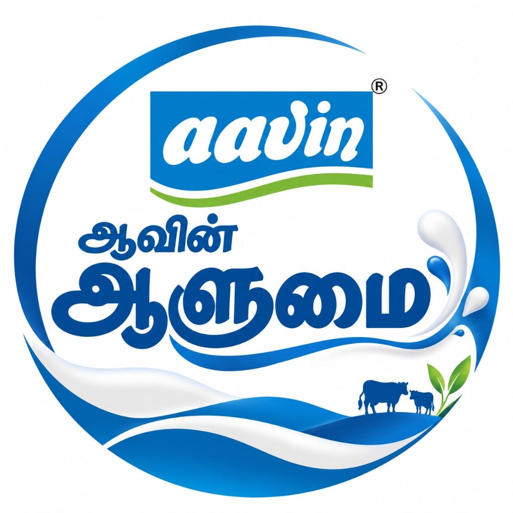

# Aavin Aalumai Shift Counter Ledger
### Production-Grade Industrial Milk Production Monitoring & Tamper-Evident Evidence Platform



Full-stack tamper-evident industrial dairy production monitoring platform designed for the **Aavin** dairy network. Digitizes cumulative packet counters from Vertical Form Fill Seal (VFFS) pouch packaging machines at shift boundaries, securing every reading in an independent SHA-256 cryptographic hash chain backed by photographic evidence, in-app OCR, two-person supervised witnessed resets, and daily signed external hash anchors.

---

## 🏛️ System Components

1. **Backend API (`backend/`)**: Python 3.12+ FastAPI, SQLAlchemy 2.x, Alembic, PostgreSQL / SQLite (zero-config dev fallback), Pydantic v2, Argon2id, JWT with refresh-token rotation, MinIO / S3 evidence storage, Redis background tasks.
2. **Web Dashboard (`dashboard/`)**: React 18, TypeScript, Vite, Tailwind CSS, Recharts, TanStack Query, Lucide icons, responsive industrial theme extracted from the official Aavin logo.
3. **Mobile Application (`mobile/`)**: Flutter Android application with Material 3, Riverpod, GoRouter, in-app camera capture (gallery upload disabled for evidence integrity), Google ML Kit OCR, offline encrypted SQLite queue, and monotonic time synchronization.
4. **Design System (`design-system/`)**: Centralized design tokens (colors, typography, spacing, radius, shadows) extracted directly from the official Aavin Aalumai logo (`#017CCA`, `#014A97`, `#7CB736`).

---

## 🚀 Quick Start (Development)

### 1. Backend (FastAPI)
```bash
cd backend
python -m venv venv
# Windows:
venv\Scripts\activate
# Linux/macOS:
source venv/bin/activate

pip install -r requirements.txt
python -m app.db.init_db    # Seeds machines (7), heads (14), shifts (3), roles (4), demo users & genesis hashes
uvicorn app.main:app --reload --port 8000
```
- API Docs (Swagger UI): `http://localhost:8000/docs`
- Health Check: `http://localhost:8000/api/v1/health`

### 2. Official Web Dashboard (React + Vite)
```bash
cd dashboard
npm install
npm run dev
```
- Web Dashboard: `http://localhost:5173`
- Default Login Credentials:
  - **Official**: `official@aavin.tn.gov.in` / `Official@123`
  - **Supervisor**: `supervisor@aavin.tn.gov.in` / `Supervisor@123`
  - **Worker**: `worker@aavin.tn.gov.in` / `Worker@123`
  - **Admin**: `admin@aavin.tn.gov.in` / `Admin@123`

### 3. Mobile Application (Flutter)
```bash
cd mobile
flutter pub get
flutter run
```

### 4. Docker Compose (Full Stack)
```bash
docker compose up --build
```

---

## 🔐 Core Industrial Principles

- **Record What Was Observed**: Store confirmed count, original OCR value, and original photographic evidence separately.
- **Append-Only Database**: Historical readings, reset events, and hash chain records can never be edited or deleted. Database-level triggers prevent `UPDATE` and `DELETE`.
- **SHA-256 Hash Chain**: Each of the 14 machine heads maintains an independent tamper-evident cryptographic hash chain from its genesis record.
- **Witnessed Resets (1,000,000 Threshold)**: Resets require before/after photographs, two-person supervisor verification, and calculate production via `(1,000,000 - Prev) + New`.
- **Time Anchoring**: Monotonic clock delta against server time anchors prevents device time manipulation.
